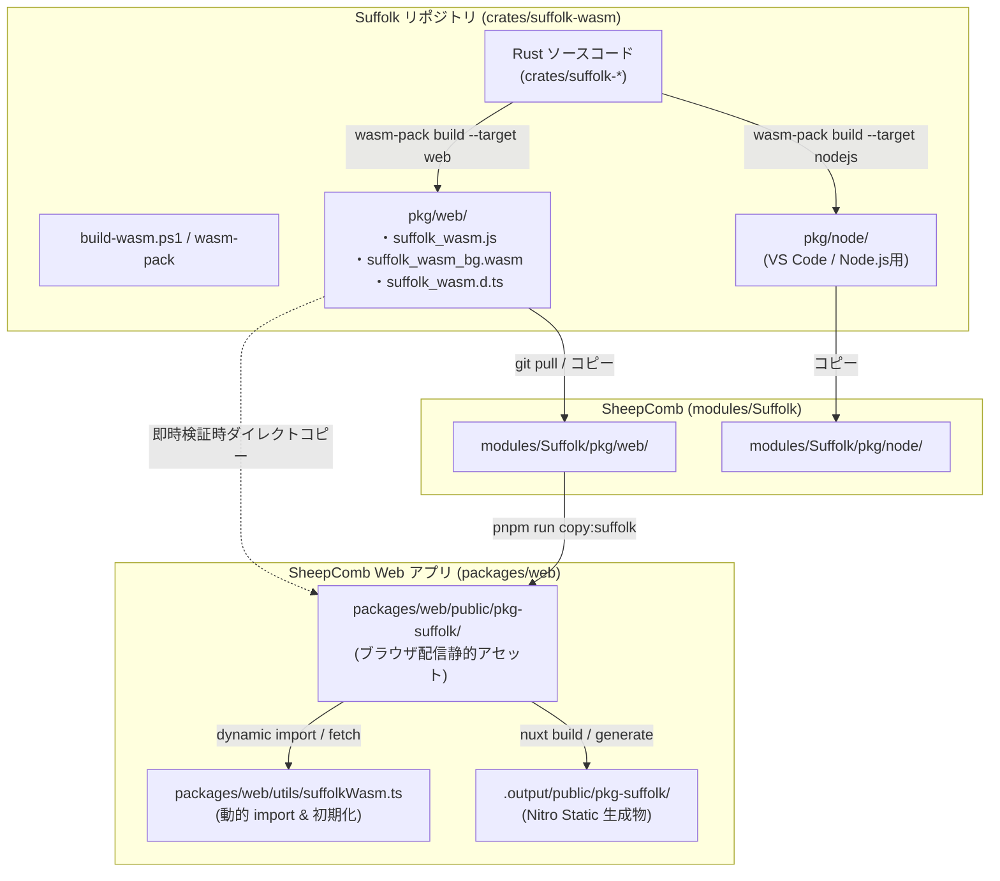

# Suffolk (WASM) アップデート手順書 (SUFFOLK_UPDATE.md)

SheepComb は、Java 不要の高速フィルター・セグメンテーション・マージエンジンとして **Suffolk**（Rust 製）をブラウザ向け WASM（WebAssembly）経由で採用しています。
Suffolk は現在開発が活発に行われており、セグメンテーションルールや対応フォーマットの更新が頻繁に発生します。
本書は、Suffolk の更新から SheepComb への反映、検証、トラブルシューティングまでの標準手順をまとめた運用マニュアルです。

---

## 1. 全体構造と依存関係フロー

SheepComb は Nuxt 4 (Vue 3 / Vite / Nitro PWA) アプリケーションであり、ブラウザ上で直接 WASM を実行するアーキテクチャを採用しています。
Suffolk の WASM バイナリおよび JS バインディングが SheepComb に組み込まれるまでの流れは以下の通りです。



### 主要パス一覧
| 役割 | パス | 備考 |
| :--- | :--- | :--- |
| **Suffolk ソース** | `../Suffolk` または `modules/Suffolk` | Rust 実装本体 |
| **Suffolk Web WASM 出力** | `../Suffolk/pkg/web/` | `wasm-pack --target web` の出力先 |
| **SheepComb サブモジュール** | `modules/Suffolk` | Git サブモジュール（Rust ソース管理） |
| **サブモジュール内 WASM** | `modules/Suffolk/pkg/web/` | `copy:suffolk` のコピー元 |
| **Web 静的アセット配信元** | `packages/web/public/pkg-suffolk/` | ブラウザから直接 `/app/pkg-suffolk/...` で取得される実体 |
| **WASM ローダー** | `packages/web/utils/suffolkWasm.ts` | `initSuffolkWasm()` などの TS ラッパー |
| **Nuxt ビルド出力先** | `packages/web/.output/public/pkg-suffolk/` | `pnpm build` 時に配置される成果物 |

---

## 2. 標準アップデート手順 (3ステップ)

Suffolk を更新する際、通常は以下の 3 ステップ（ビルド ➔ 反映 ➔ 検証）で完了します。

### ステップ 1: Suffolk リポジトリで WASM をビルドする

Suffolk リポジトリで変更を行った後、WASM（Web向けおよびNode.js向け）をビルドします。

```powershell
# Suffolk リポジトリに移動してビルドスクリプトを実行
Push-Location "..\Suffolk"
powershell -ExecutionPolicy Bypass -File .\build-wasm.ps1
Pop-Location
```

> **手動で wasm-pack を実行する場合（Web向けのみ）**:
> ```powershell
> cd ..\Suffolk
> wasm-pack build crates/suffolk-wasm --target web --out-dir ../../pkg/web --release
> ```

---

### ステップ 2: SheepComb への反映（サブモジュール更新 & WASM 同期）

#### パターン A: リモートの最新 Suffolk を取り込む場合 (推奨)
Suffolk リポジトリの変更がプッシュされた後、サブモジュールを pull して生成物を同期します。

```powershell
# 1. サブモジュールをリモートの最新 main に更新
git submodule update --remote modules/Suffolk

# 2. 生成された WASM を modules/Suffolk 配下に同期
Copy-Item -Path "..\Suffolk\pkg\web\*" -Destination "modules\Suffolk\pkg\web\" -Recurse -Force
Copy-Item -Path "..\Suffolk\pkg\node\*" -Destination "modules\Suffolk\pkg\node\" -Recurse -Force

# 3. packages/web/public/pkg-suffolk にコピー (package.json 定義スクリプト)
pnpm run copy:suffolk

# 4. Nuxt Web アプリケーションのビルド確認
pnpm --filter @sheep-comb/web build
```

#### パターン B: ローカルで試作中の Suffolk を即時検証する場合
コミットやプッシュを行わずにローカルの最新ビルドをすぐ試したい場合：

```powershell
# Suffolk から直接 packages/web/public/pkg-suffolk に上書きコピー
Copy-Item -Path "..\Suffolk\pkg\web\*" -Destination "packages\web\public\pkg-suffolk\" -Recurse -Force

# 開発サーバーを起動してブラウザで確認
pnpm dev
```

---

### ステップ 3: 動作検証 (Smoke Test)

ビルド完了後、Node.js スクリプトやワンライナーで最新機能が正常に動作するか確認します。

#### ① 初期化とバージョン確認
```powershell
node -e "
import('./packages/web/public/pkg-suffolk/suffolk_wasm.js').then(async suffolk => {
  const fs = await import('node:fs');
  const wasm = fs.readFileSync('packages/web/public/pkg-suffolk/suffolk_wasm_bg.wasm');
  await suffolk.default({ module_or_path: wasm });
  console.log('Suffolk Version:', suffolk.suffolk_version());
});
"
```

#### ② 連続約物（！？、？！、！！、？？）のセグメンテーション確認
```powershell
node -e "
import('./packages/web/public/pkg-suffolk/suffolk_wasm.js').then(async suffolk => {
  const fs = await import('node:fs');
  const wasm = fs.readFileSync('packages/web/public/pkg-suffolk/suffolk_wasm_bg.wasm');
  await suffolk.default({ module_or_path: wasm });
  console.log(suffolk.suffolk_vscode_segment_text('本当ですか！？それはすごいですね？！信じられない！！何だって？？'));
});
"
```
**期待される結果**:
```json
[ "本当ですか！？", "それはすごいですね？！", "信じられない！！", "何だって？？" ]
```
※ 約物の前後で不当に分断されず、1文として保持されていること。

#### ③ Excel (XLSX) TargetCell 自動保持 & 空オプションマージ確認
```powershell
node -e "
import('./packages/web/public/pkg-suffolk/suffolk_wasm.js').then(async suffolk => {
  const fs = await import('node:fs');
  const wasm = fs.readFileSync('packages/web/public/pkg-suffolk/suffolk_wasm_bg.wasm');
  await suffolk.default({ module_or_path: wasm });
  const xlsx = fs.readFileSync('../Suffolk/test_data/Device_Config.xlsx');
  const res = suffolk.suffolk_browser_extract(xlsx, 'test.xlsx', { xlsxSource: 'A', xlsxTarget: 'B' });
  console.log('Note 0:', res.body.units[0].note);
  const merged = suffolk.suffolk_browser_merge(xlsx, 'test.xlsx', res, {});
  console.log('Auto Merge Success! Length:', merged.length);
});
"
```
**期待される結果**:
- `Note 0` に `@sf[Sheet: Sheet1 | Cell: A2 | TargetCell: B2]` のように `TargetCell` が含まれていること。
- `suffolk_browser_merge` の第4引数が空オプション `{}` でもエラーにならず、マージバイナリが返ること。

---

## 3. トラブルシューティング & 注意点

### Q1. `git submodule update` が `Permission denied` や `NtCreateDirectoryObject` (0xC0000022) で失敗する
- **原因**: Windows 環境（特にサンドボックスや権限分離機能）において、MSYS2 / Git のサブプロセス（`sh.exe`）が `.git/modules` にアクセスする際にアクセス拒否される場合があります。
- **対処法**:
  - 管理者権限または通常の PowerShell ターミナルから直接実行する。
  - AI エージェント等のサンドボックス実行時は `BypassSandbox: true` を指定する。

### Q2. サブモジュールを git pull しても `modules/Suffolk/pkg` が更新されない
- **原因**: `wasm-pack` の仕様により、ビルド時に `pkg/web/.gitignore` に `*` が自動生成されます。そのため Suffolk リポジトリ側では `pkg/` フォルダ自体が Git の追跡対象外（ignore）となっています。
- **対処法**:
  - `../Suffolk/pkg/web` から `modules/Suffolk/pkg/web` および `packages/web/public/pkg-suffolk` へ手動同期（Copy-Item）を行ってください。

### Q3. `pnpm run copy:suffolk` を実行したら古い WASM に戻ってしまった
- **原因**: `pnpm run copy:suffolk` は `modules/Suffolk/pkg/web` から `packages/web/public/pkg-suffolk` へコピーするスクリプトです。`modules/Suffolk/pkg/web` のファイルが古いままの場合、古いファイルで上書きされてしまいます。
- **対処法**:
  - `Copy-Item -Path "..\Suffolk\pkg\web\*" -Destination "modules\Suffolk\pkg\web\" -Recurse -Force` を事前に実行してサブモジュール側の `pkg/` も最新にしておくか、直接 `packages/web/public/pkg-suffolk` にコピーしてください。

### Q4. `suffolk_version()` のバージョン表記が上がらない
- **原因**: Suffolk 側の `crates/suffolk-wasm/Cargo.toml` またはルート `Cargo.toml` の `version = "x.y.z"` が更新されていない場合、`CARGO_PKG_VERSION` は旧バージョンのまま出力されます。
- **対処法**: Suffolk 側の `Cargo.toml` のバージョン表記を確認・更新して再ビルドしてください。

---

## 4. サブモジュールのコミットとプッシュ

SheepComb 側でサブモジュールの参照コミットおよび更新された静的 WASM ファイルを確定してコミットする場合：

```powershell
# サブモジュールの参照ポインタ更新と WASM 静的アセットをステージング
git add modules/Suffolk packages/web/public/pkg-suffolk

# コミット
git commit -m "chore: update Suffolk submodule and WASM to v1.1.2"
```
